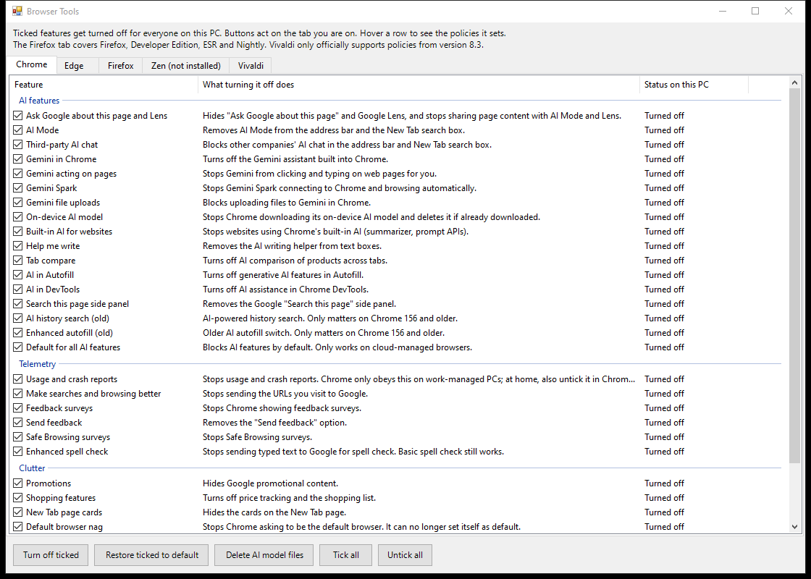

# Browser Tools

A small Windows tool that turns off AI features, telemetry and clutter in **Chrome, Edge, Firefox, Zen, Vivaldi, Brave and Helium** using official browser policies. You get a window with a ticklist per browser, a short explanation for every setting, and its current status on your PC. It follows your Windows light or dark mode, and switches when you change it.



## Run it

**One line (no download):** press `Win + R`, paste this and press Enter:

```
powershell -ExecutionPolicy Bypass -c "irm https://raw.githubusercontent.com/AnimeKaizoku/Browser-Tools/main/Browser-Tools.ps1 | iex"
```

**Or download it:** save [`Browser-Tools.ps1`](Browser-Tools.ps1), right-click it and pick **Run with PowerShell**.

Either way it asks for administrator rights, because browser policies live under `HKEY_LOCAL_MACHINE`.

## Using it

- Pick a browser tab. Recommended settings (AI, Telemetry, Privacy, Clutter) are already ticked.
- The **Optional** group is unticked because each one changes how the browser behaves: search suggestions, Memory Saver and sleeping tabs, background timer throttling, hiding your local IP from WebRTC, strict tracking protection, HTTPS warnings, blocking notification, location and device prompts, blocking dangerous downloads, and turning off the built-in password manager or card autofill.
- **Tick recommended** goes back to those ticks on the current tab: everything except the Optional group.
- **Turn off ticked** writes the policies. Restart the browser afterwards.
- **Restore ticked to default** removes them again, so the browser goes back to normal.
- **Delete AI model files** frees the on-device AI model (several GB) that Chrome and Edge download. Firefox and Zen delete their own models once their AI features are blocked.
- **Back up policies before changes** (ticked) saves the tab's policies to `Documents\Browser Tools backups` as a `.reg` file before every change. Double-click one to go back to exactly those policies, including removing any added since.
- **Clean up old policies** lists policies on that tab that the browser no longer uses or that a newer policy replaced (for example old Privacy Sandbox settings in Chrome), and removes them after you confirm.
- **Save ticks...** and **Load ticks...** store the ticks of every tab in a small `.json` file, so you can share your setup and load it on another PC. Loading only sets the ticks; click **Turn off ticked** on each tab to apply.
- Hover a row to see exactly which policies it sets.

You can check what a browser picked up at `chrome://policy`, `edge://policy`, `about:policies` (Firefox, Zen), `vivaldi://policy`, `brave://policy` or `helium://policy`.

## Good to know

- Works on any Windows 10 or 11 PC, Home or Pro. No enterprise editions needed.
- After applying, browsers show **"Managed by your organization"**. That is normal whenever policies are set, not malware.
- Chrome, Edge, Vivaldi, Brave and Helium switch off their automatic encrypted DNS as soon as any policy is set. The ticked **Keep encrypted DNS on** setting turns it back on.
- **Firefox** tab covers Firefox, Developer Edition, ESR and Nightly (they share one policy key). **Zen** reads its own key, so it has its own tab.
- **Chrome:** "Usage and crash reports" is only obeyed on work-managed PCs; at home, also untick it in Chrome settings.
- **Edge:** there is no policy that removes the Copilot button for personal Microsoft accounts. Items marked "(work accounts)" only apply to work or school profiles.
- **Vivaldi** reads policies but only officially supports them from version 8.3.
- **Brave:** its VPN and Tor windows are in the Optional group. The tab also covers Brave Beta and Nightly.
- **Helium** is built on ungoogled-chromium, which already removes Google's AI, telemetry and sign-in, so its tab is short. It reads its own policy key (`HKLM\SOFTWARE\Policies\Helium`).
- Settings you change here apply to every user on the PC.
